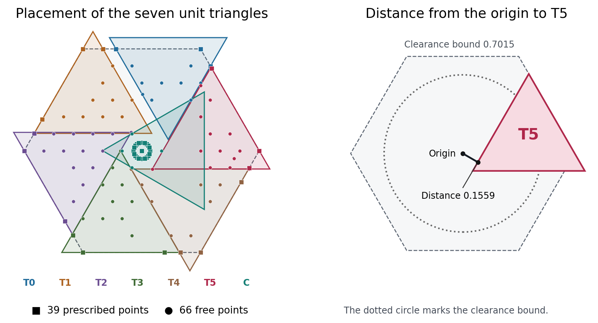

# Covering a regular hexagon with seven equilateral triangles

**English** · [한국어](README.md)

**Jineon Baek and Jeewon Kim gave an earlier proof that seven unit equilateral triangles cannot cover a regular hexagon of side length greater than one.** This repository presents our route to the same theorem and a finite result that came out of the proof. The same 105 points can be covered by seven triangles, yet the cover becomes impossible when just one triangle must keep a specified distance from the origin. [Baek and Kim’s manuscript](https://github.com/dylan0301/hexagon-cover-database/blob/47a136fcdb3b31d46d0bb1a54da81c2cf73b8222/arrange/paper_draft/main.pdf) · [Baek’s Lean formalization](https://github.com/jcpaik/hexagon-cover-formalization/tree/545a609e0225e664dc830310641f2ec0170ee181)

## How the proofs differ

A regular hexagon of side one splits into six unit equilateral triangles along the rays from its center to its vertices. Could one extra triangle cover even a slightly larger hexagon if all seven pieces were free to move? The theorem rules this out for **every** side length $s>1$. Each closed triangle may rotate and translate independently. Overlaps and protrusions beyond the hexagon are allowed.

In a hypothetical cover, one triangle must contain the center and each of the other six must contain a different vertex. Our proof studies how far each outer triangle reaches along the two edges meeting at its vertex, after reducing to the unit hexagon. A **gap** is an interval of positive length on an edge missed by both outer triangles at its ends. Exactly one outer triangle would have two reaches adding up to more than one. We label it $T_5$ and write $M$ for its longer reach.

| Case | Where the contradiction comes from |
|---|---|
| There is a boundary gap | In eight of nine patterns, we force the central triangle to contain two points more than one unit apart. When the only gap lies on edge $E_4$, we split the argument according to whether a particular interior point belongs to $T_2$. |
| No gaps, large $M$ | Our geometric proof follows actual edge endpoints and interior points over three ranges of $M$. Baek and Kim handle the entire gap-free case with one argument, which is shorter here. |
| No gaps, small $M$ | Baek and Kim force nine parameter-dependent points into **one central triangle**. We fix point coordinates on each of eleven intervals and allow different triangles to cover them. **Every assignment** eventually requires some triangle to contain a set of points it cannot fit. |

[Detailed comparison](docs/proof-comparison.en.md) · [Walk through the proof](docs/proof-guide.en.md) · [The theorem in Lean](lean/HexagonCover/SemanticFinal.lean)

## One distance condition changes the answer for 105 points

Take 105 fixed points in the **unit** hexagon. Of these, 39 have a prescribed covering triangle. Each of the six outer triangles must contain three of them, and the central triangle must contain 21. Any of the seven triangles may cover each of the remaining 66. Keep every coordinate and every prescribed assignment fixed.

| Condition on $T_5$ | Can all 105 points be covered? | Evidence |
|---|---|---|
| The distance from the origin to the entire closed triangle $T_5$ is at least $81\sqrt{3}/200$. | **No.** | An exact certificate checks every possible assignment of the free points. |
| Remove that distance bound. | **Yes.** | One placement gives all seven triangles explicitly, with $d(0,T_5)=9\sqrt{3}/100$. |



Why does this restriction matter? In the pictured placement, $T_5$ covers point 134 at $(7/12,\sqrt{3}/12)$. Its squared distance from the origin is $13/36$, already less than the square of the required clearance. Restoring the bound forces this point to change hands. The certificate shows that even after **all** the free points can be reassigned, no cover survives. The exact largest attainable clearance remains open. [Exact point coordinates](finite/data/points.json) · [Placement](finite/data/vertices.json) · [Assignment tree](finite/data/tree.json)

We have found no result in the public sources we examined that gives this particular pair of finite conclusions. Our literature review records both the results we could compare and the two manuscripts whose full texts we could not obtain. [Sources and limits of the comparison](docs/sources.en.md)

## Verify the results

Run these commands from the repository root with Python 3.9 or newer. Both use only the standard library. The first checks the 21 unit sides and coverage of all 105 points. The second checks the impossibility certificate with the distance bound in force.

```sh
python3 -B finite/verify.py without-distance
python3 -B finite/verify.py with-distance
```

The theorem about the **whole hexagon** has a Lean proof. On November 17, 2026, we compiled all 1,041 project modules starting with an empty local build directory and replayed the proof in a fresh Lean kernel environment. For the release we checked the hashes of 1,015 prerequisite modules and recompiled the two top-level modules in a fresh clone. The two finite results above have their own exact arithmetic checks. [Finite verification details](finite/README.md) · [Build the Lean proof](lean/README.md) · [Verification record](lean/verification.json)

**tom231826-svg** directed the research and chose which cases to investigate. **Codex, Claude and Antigravity** contributed to proof exploration, certificate construction and cross-checking.
