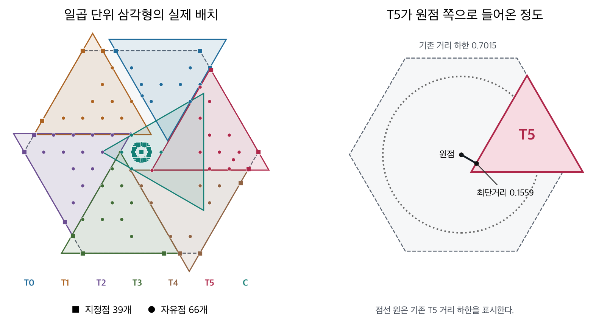

# 정육각형을 덮는 일곱 정삼각형

백진언(Jineon Baek)과 김지원(Jeewon Kim)은 **한 변이 1보다 큰 정육각형을 단위 정삼각형 일곱 개로 완전히 덮을 수 없다**는 것을 먼저 증명했다. 이 저장소는 우리가 같은 정리에 도달한 다른 증명 경로와 검산 자료를 공개한다. 두 증명의 차이가 특히 잘 드러나는 사례가 있다. **같은 105점을 그대로 두고, 한 삼각형이 원점에 얼마나 가까이 올 수 있는지에 따라 덮기의 가능 여부가 바뀐다.** [백진언·김지원의 선행 원고](https://github.com/dylan0301/hexagon-cover-database/blob/47a136fcdb3b31d46d0bb1a54da81c2cf73b8222/arrange/paper_draft/main.pdf) · [백진언의 Lean 형식화](https://github.com/jcpaik/hexagon-cover-formalization/tree/545a609e0225e664dc830310641f2ec0170ee181)

**English.** Jineon Baek and Jeewon Kim gave an earlier proof of the seven-triangle hexagon theorem. This repository gives another proof and an exact finite example. Seven closed unit equilateral triangles can cover the same 105 specified points with the prescribed roles. Requiring just one of those triangles to stay at distance at least $81\sqrt{3}/200$ from the origin makes that covering impossible. The coordinates, a feasible placement and a certificate excluding every assignment under the distance bound are included.

## 같은 정리, 다른 증명

삼각형은 각각 자유롭게 움직이고 회전한다. 서로 겹치거나 육각형 밖으로 나가도 된다. 한 변이 정확히 1인 육각형은 중심과 이웃한 꼭짓점을 이은 여섯 조각만으로 덮인다. 증명할 것은 **아무리 조금이라도 육각형을 키우면 일곱 조각으로 부족하다**는 것이다.

덮개가 있다고 가정하면 중심을 맡는 조각과 꼭짓점 여섯 개를 각각 맡는 조각을 구별할 수 있다. 아래에서 ‘틈’은 한 변의 양 끝을 맡은 외곽 조각들이 그 변에서 덮지 못한 구간이다. $M$은 두 인접 변에서 덮는 길이의 합이 1을 넘는 유일한 외곽 조각이 한쪽 변을 따라 도달하는 최대 길이다.

| 경우 | 우리 증명에서 모순을 찾는 곳 |
|---|---|
| 경계에 틈이 있다 | 아홉 경우 중 여덟 경우에서 같은 중앙 조각이 거리 1보다 먼 두 점을 맡아야 한다. 한 변 $E_4$에만 틈이 있는 경우에는 특정 내부점을 $T_2$가 덮는지에 따라 두 갈래로 나눈다. |
| 틈이 없고 $M$이 크다 | 우리 기하 증명은 세 구간에서 실제 경계 끝점과 내부점을 추적한다. 선행 원고는 무틈 범위를 한 논증으로 처리해 이 대목이 더 간결하다. |
| 틈이 없고 $M$이 작다 | 선행 원고는 매개변수에 따라 정해지는 아홉 점을 **같은 중앙 삼각형**에 강제한다. 우리는 열한 구간에서 점의 좌표를 고정하고 **어느 삼각형이 각 점을 맡더라도** 결국 한 조각이 자기 점들을 다 담지 못함을 증명한다. |

[세 경우를 원문과 대조한 표](docs/proof-comparison.md) · [전체 증명 길잡이](docs/proof-guide.md) · [자유로운 이동·회전으로 쓴 Lean 정리](lean/HexagonCover/SemanticFinal.lean)

## 105점에서 조건 하나를 바꾸면

39점은 담당이 정해져 있다. 외곽 여섯 조각은 각각 세 점을 맡고 중앙은 21점을 맡는다. 나머지 66점은 어느 조각이든 덮을 수 있다. 두 실험은 **같은 105개 좌표와 같은 담당 조건**을 사용한다. $d(0,T_5)$는 원점에서 닫힌 삼각형 $T_5$ 전체까지의 최단거리다.

| $T_5$에 주는 조건 | 정확한 결과 | 확인할 수 있는 증거 |
|---|---|---|
| $d(0,T_5)\geq 81\sqrt{3}/200$ | **불가능** | 가능한 담당을 빠짐없이 분기한 인증서. 각 가지에서 한 삼각형이 담아야 할 점들을 실제로 담을 수 있는지 검사한다. |
| 거리 하한을 삭제 | **가능** | 일곱 삼각형의 정확한 좌표. 이 배치에서 $d(0,T_5)=9\sqrt{3}/100$이고 105점이 모두 덮인다. |



그림에서 $T_5$는 134번 점 $(7/12,\sqrt{3}/12)$을 덮는다. 이 점은 원점에서 거리 제곱이 $13/36$이라서, 거리 하한을 복원하면 $T_5$가 맡을 수 없다. **다른 조각이 대신 맡으면 될까?** 불가능 쪽의 검산기는 그런 재배정까지 모두 확인한다. 그림은 거리 하한을 뺀 배치를 보여 주고, 105점의 덮임은 아래 명령으로 정확한 좌표에서 검사한다. [점 목록](finite/data/points.json) · [담당 분기 인증서](finite/data/tree.json)

가능에서 불가능으로 바뀌는 정확한 임계 거리는 열려 있다. 확인한 공개 문헌에서는 이 특정 점 집합과 거리 조건에서 같은 결론을 주는 선행 결과를 찾지 못했다. [문헌 대조와 미확인 자료](docs/sources.md)

## 직접 검산하기

저장소 최상위에서 다음 두 명령을 실행한다. Python 표준 라이브러리만 사용한다. 첫 명령은 21개 변의 길이와 점의 포함을 검사하고, 둘째 명령은 거리 하한 아래의 전 분기를 검사한다.

```sh
python3 -B finite/verify.py without-distance
python3 -B finite/verify.py with-distance
```

원래 육각형 전체에 대한 증명은 Lean으로 확인할 수 있다. 11월 17일에는 로컬 모듈 1,041개를 빈 빌드 폴더에서 컴파일하고 새 Lean 커널 환경에서 재검사했다. 공개 직전에는 복제본에서 기존 빌드의 의존 모듈 1,015개를 해시로 대조하고 최상위 두 모듈을 다시 컴파일했다. 105점의 두 판정은 위의 별도 정확 산술 검산기를 사용한다. [105점 검산 방법](finite/README.md) · [Lean 빌드 방법](lean/README.md) · [공개본 검증 기록](lean/verification.json)

**tom231826-svg**가 연구 질문과 다음에 검토할 경우를 정하며 진행한 AI 협업 프로젝트다. **Codex, Claude, Antigravity**가 증명 탐색, 계산 인증서 작성과 교차 검토에 참여했다. 각 결론의 근거는 위에 연결한 증명, 좌표, 검사기에서 확인할 수 있다.
