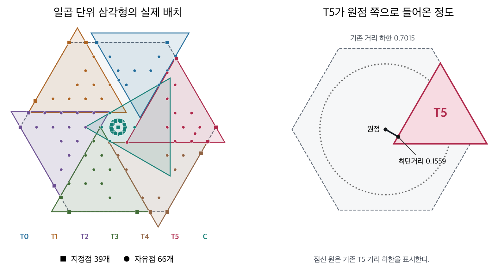

# A clearance condition changes a 105-point covering problem

Take the seven **closed** unit equilateral triangles $T_0,\ldots,T_5,C$ in the plane. Each may rotate and translate independently. Of the 105 distinct fixed points, 39 have prescribed triangles (three for each outer role, twenty-one for $C$). Each of the other 66 may belong to any of the seven. All coordinates and prescribed roles are in [points.json](data/points.json). A coordinate triple $[x,y,z]$ denotes $(x,y+z\sqrt3)$.

| Hypothesis on the actual closed triangle $T_5$ | Can the 105 points be covered simultaneously? |
|---|---|
| Free position, subject to the three prescribed points | Yes. [Exact vertices](data/vertices.json) |
| The same conditions, plus $\operatorname{dist}(0,T_5)\ge 81\sqrt3/200$ | No. [Ownership tree](data/tree.json) and [angle certificate](data/interval-402.json) |

The distance is the infimum over the whole triangle, including its sides and interior. The label **0.81–0.83** identifies the original source of the point coordinates. Neither test imposes a further restriction on the triangles’ boundary reaches. The proposition concerns these 105 points in the unit hexagon. The two outcomes show that the specified distance condition cannot simply be dropped. They leave open the exact largest attainable clearance.

## Reproduce

From the repository root, run either command with Python 3.9 or newer. The checks use only its standard library. No solver, downloads, or regenerated search trees are needed.

```sh
python3 -B finite/verify.py without-distance
python3 -B finite/verify.py with-distance
```

The first command checks all 21 squared side lengths, closed inclusion of the 39 prescribed points in their assigned triangles, coverage of all 66 free points, and the squared distance $243/10000$ for the displayed $T_5$. Each coordinate in the vertices file is a pair $[a,b]$ representing $a+b\sqrt3$.



The second command reads the original packet and tree, compares the prescribed roles and actual query coordinates with the published input, and verifies every reachable ownership branch. It visits 149 nodes and 468 distinct geometric contradictions. It checks that a leaf uses only prescribed points and points **already assigned to the same triangle on that path**. An actual simultaneous cover could follow the tree by choosing an owner at each queried point, even if multiple triangles cover it. Every such path ends in a checked contradiction.

## What certifies a contradiction?

* **324 pairwise distances and 135 support tests.** A pair more than one unit apart cannot share a triangle. For a convex hull and a fixed orientation, let $s_j$ be its support values in three unit normal directions $120^\circ$ apart. A translate of the unit triangle contains the hull exactly when $\sum_j s_j\le\sqrt3/2$. The three offsets of the triangle sum to its height; each offset must be at least its corresponding support value. Between successive supporting-vertex changes, $S(\theta)=\sum_j s_j$ is a fixed linear combination of sine and cosine. Also $S\ge0$ since the three normals sum to zero. Hence $S''=-S\le0$ there, and a minimum occurs at a switching angle. The checker tests every hull edge normal with its two rotations using exact arithmetic in $\mathbb Q(\sqrt3)$. Equality always remains feasible.
* **9 clearance contradictions.** In eight, a required point or the segment joining two required points enters the **open** excluded disk. In the ninth (fact 402), those simple witnesses do not suffice. At fixed orientation, feasible translations form a simplex in the three supporting offsets. Its vertices allocate all slack in turn to each of the three sides. The distance from the origin to a translate of a fixed convex triangle is convex in that translation. If every extreme triangle has distance strictly below the threshold, so does every feasible translate. The [interval data](data/interval-402.json) and [rational interval checker](intervals.py) check 82 contiguous closed angular intervals, using $t=\tan(\theta/2)\in[-1,1]$ to cover at least a full $120^\circ$ period. On each interval either no fit is possible, or all three extreme translations enter the open disk. Tangency alone never establishes a contradiction.
* **Why all 66 points may choose any owner.** The archived tree omits the central branch only for point 165. Four of the prescribed central points are $(\pm r,0),(0,\pm r)$, where $r=1411/20000$. Their convex hull contains the disk of radius $\rho=1/21$ about the origin because $r^2\ge2\rho^2$. Thus any admissible $C$ contains that disk. The set of possible disk centers inside a unit triangle is the triangle obtained by moving its three edges inward by $\rho$. The maximum squared distance from that smaller triangle to any point of the original triangle occurs at a vertex pair. The two values from such pairs are $4\rho^2$ and $1-2\sqrt3\rho+4\rho^2$. The latter dominates for $\rho\le\sqrt3/6$ and is strictly below $373/441$ since $\sqrt3>12/7$. Point 165 is $(91/100,-9\sqrt3/100)$ and its squared norm is $2131/2500>373/441$. It cannot belong to $C$. The checker establishes the strict comparison from the input and rejects unsupported omissions.

The positive result is illustrated above by one recorded configuration. The tree on the negative side was produced with Claude-assisted ordered branching and validated in this research project. The public reader reuses the project's exact support and rational interval arithmetic; it checks the compact tree directly with all seven roles, including the omitted-center argument. The evidence proves this specified finite statement. Its priority in the literature is unconfirmed.

## File integrity and controls

The source packet, tree, point list, and interval certificate retain their original bytes. [SHA256SUMS](SHA256SUMS) identifies the distributed data. `packet.json` includes extra coordinates for the original search; the checker uses only the 105 points selected in `points.json`. Its outer wrapper records the strengthened squared distance; the nested seed packet keeps an earlier construction parameter.

```sh
python3 -B finite/test_verify.py
```

The five controls change the distance (while updating the tree-packet binding), omit a point, drop an owner, deform a triangle, and duplicate an angle interval. Each modification must be rejected.
